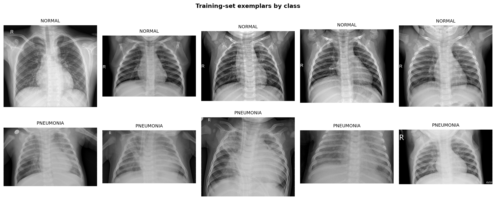
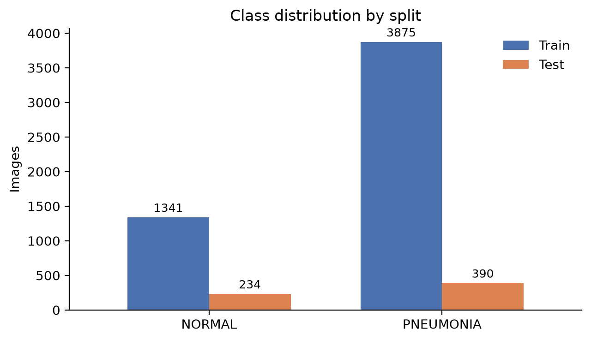
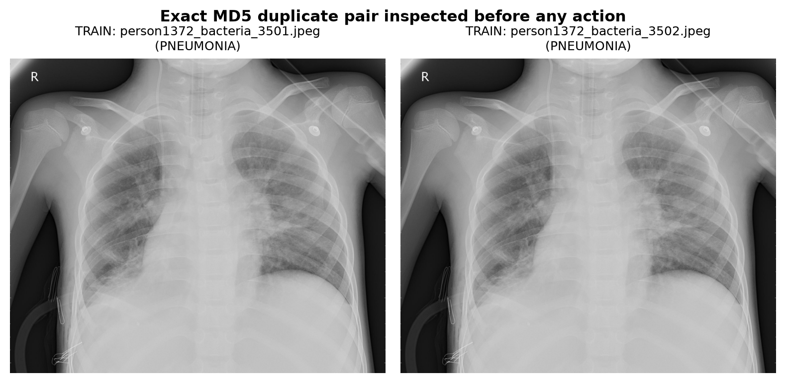
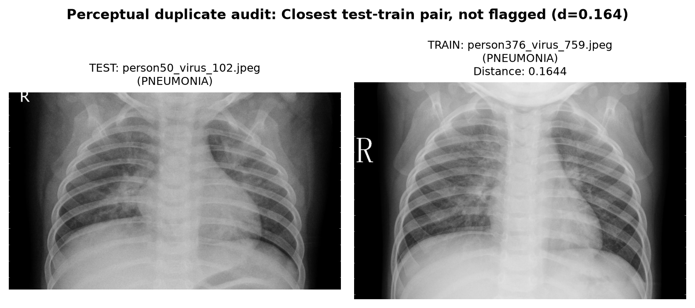
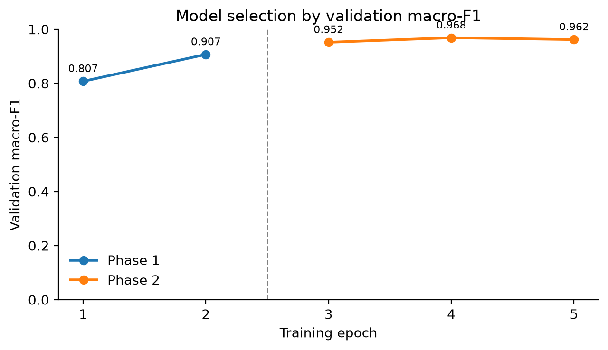
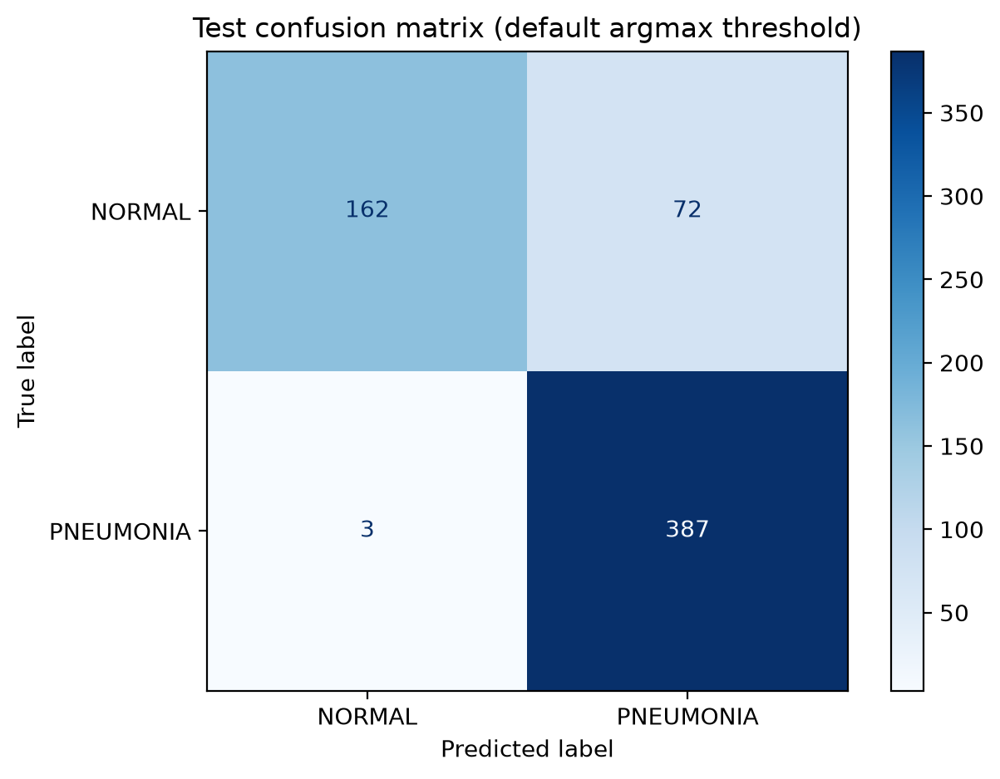
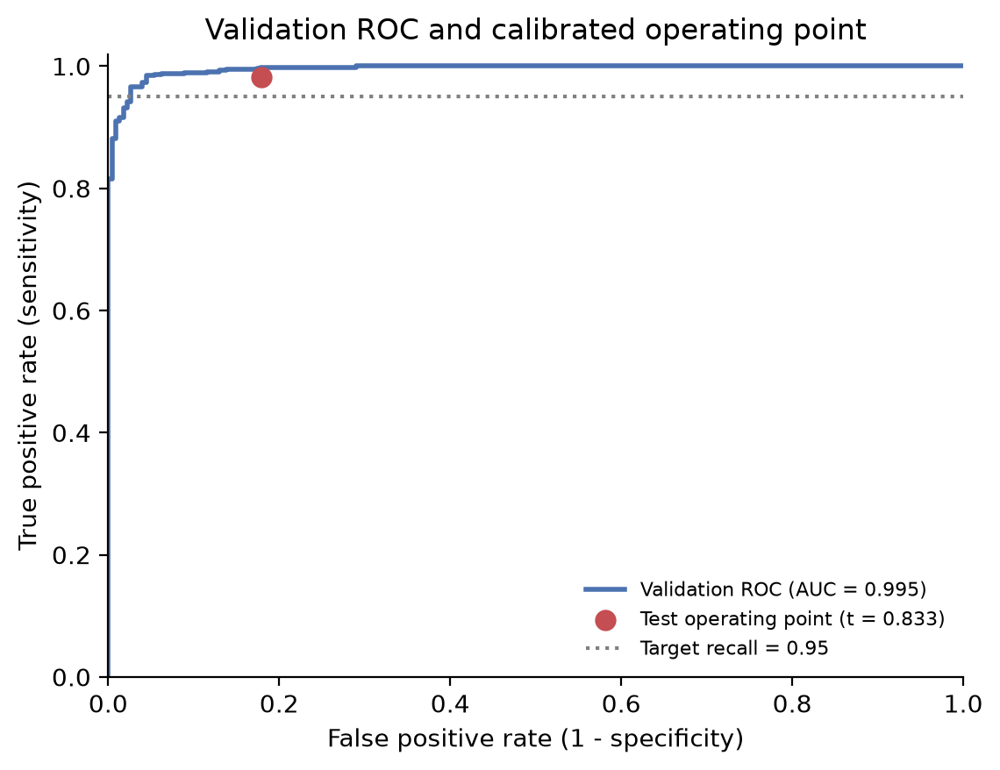
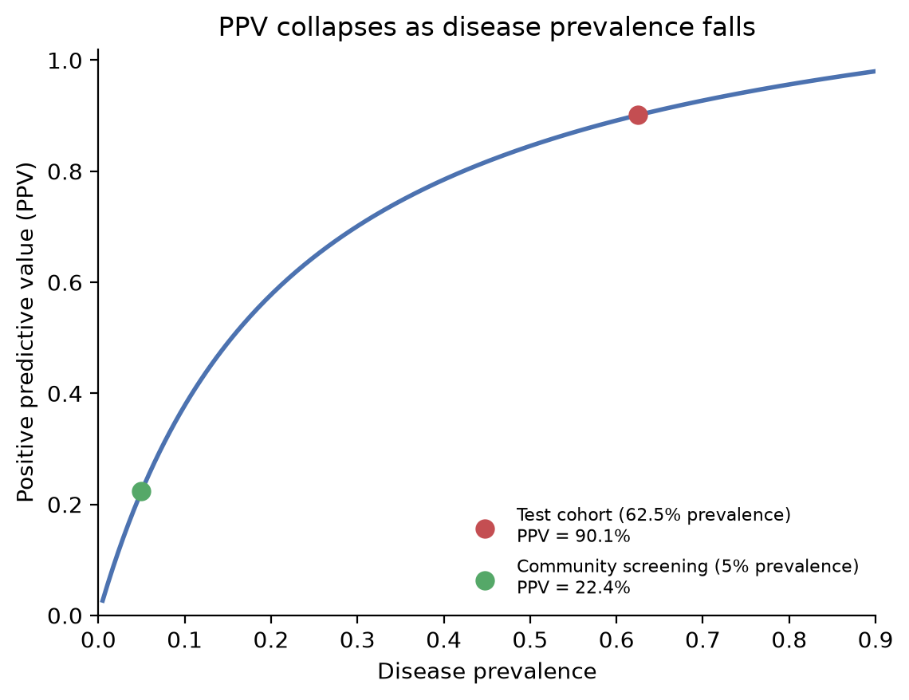
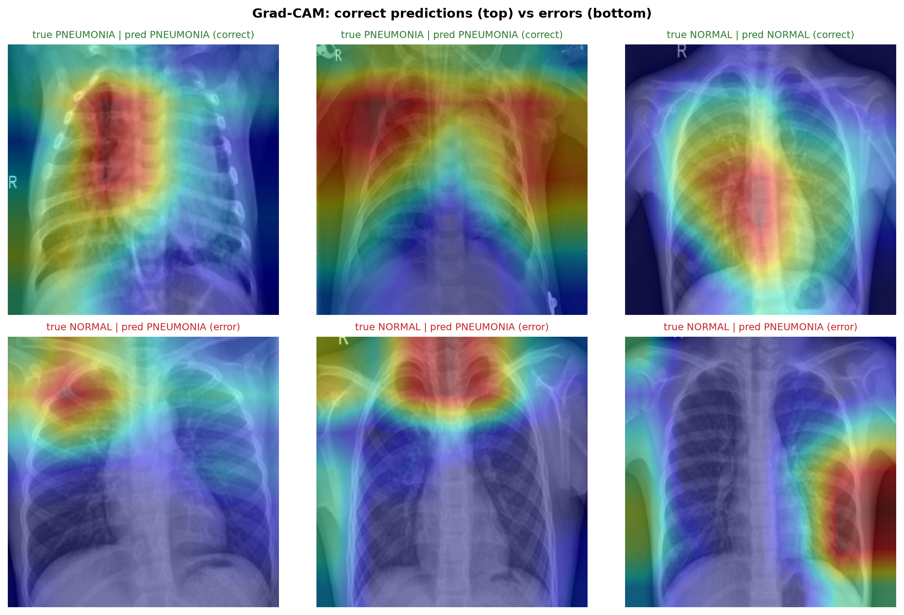

# Week 6 — Applied Computer Vision: Pediatric Pneumonia Detection with ResNet18

**Course:** Introduction to Applied AI · BS 7th Semester · Department of Electronics  
**Author:** Nosharwan Khan  
**Notebook:** [Week 6 - Chest X-Ray.ipynb](Week%206%20-%20Chest%20X-Ray.ipynb)  
**Dataset:** [Chest X-Ray Images (Pneumonia)](https://www.kaggle.com/datasets/paultimothymooney/chest-xray-pneumonia) · CC BY 4.0  
**Model:** ResNet18 (ImageNet pretrained), two-phase transfer learning  
**Task:** Binary pediatric pneumonia detection (`NORMAL` vs `PNEUMONIA`)  
**Execution:** PyTorch 2.14.1+cpu, Python 3.12, 8-core Intel i7-1165G7; notebook is Kaggle-compatible and auto-switches to `/kaggle/input` paths.

> **Headline result.** Official test macro-F1 **0.862** at the default threshold, rising to **0.913** at the validation-calibrated threshold. Calibrated sensitivity **0.982**, specificity **0.821**, test AUC **0.976**. PPV falls from **90.1%** at the test prevalence (62.5%) to **22.4%** at a realistic 5% screening prevalence.
>
> **Critical caveat.** The public Kaggle test split is **not patient-disjoint**: 170 patient groups (320/624 images, 51.3%) also appear in the training folder. The official test score is therefore an optimistic benchmark, not an external validation. This is reported explicitly rather than hidden.


*Figure 1 — Representative pediatric chest radiographs from the training split. Note the variable collimation, portability markers, and inconsistent grayscale/RGB encoding that motivate the audit.*

---

## 1. Why this problem

Pneumonia is the leading infectious cause of death in children under five. In a busy pediatric emergency department or rural triage clinic, the bottleneck is not the availability of a chest X-ray but the availability of a radiologist to read it. A model that reliably prioritises abnormal films could shorten time-to-treatment; a model that silently misses early consolidations or over-flags healthy children could cause direct harm.

This project treats the model as a **triage second reader**, not an autonomous diagnostician. That framing determines the metrics: sensitivity and PPV at clinically plausible prevalences matter more than raw accuracy, and shortcut auditing matters more than a single high test score.

---

## 2. Dataset and audit

The dataset contains 5,856 pediatric frontal chest radiographs from Guangzhou Women and Children's Medical Center (ages 1–5), labelled `NORMAL` or `PNEUMONIA` and adjudicated by two expert radiologists. The 16-image `val` folder is too small to support model selection and is ignored.

| Split | NORMAL | PNEUMONIA | Total | Patient groups |
|---|---:|---:|---:|---:|
| Training (original) | 1,341 | 3,875 | 5,216 | 2,846 (1.83 images/group) |
| Training (after grouped split) | 1,117 | 3,229 | 4,346 | — |
| Validation (grouped) | 224 | 646 | 870 | — |
| Official test | 234 | 390 | 624 | 427 |


*Figure 2 — Training imbalance is 2.89:1 toward pneumonia; the official test split is 1.67:1.*

### Integrity checks

| Check | Result | Action |
|---|---|---|
| Exact MD5 duplicates | **62 files in 30 hash groups**: 24 groups within train, 6 within test, **0 cross-split** | Retained; no cross-split copy to remove |
| Perceptual near-duplicates | **0/624** test images at $d_{\min}<0.10$; closest pair $d_{\min}=0.164$ | None removed |
| Patient groups, train vs validation | **0 shared groups** | Enforced with `StratifiedGroupKFold` |
| Patient groups, official test vs train | **170 groups / 320 images (51.3%)** shared | Reported as a leakage limitation |
| Image geometry (300-image sample) | 384–2,510 px wide, 127–2,543 px high; median 1,300×890 | Resize to 224×224 |
| Encoding (300-image sample) | 286 grayscale (`L`), 14 RGB | Convert all to single-channel `L`, then replicate to 3 channels |

<p align="center">
  
  
</p>

*Figure 3 — Left: an inspected byte-identical pair (duplicates occur only within a split). Right: the closest test–train perceptual pair, which is clearly a different acquisition and falls below the $d_{\min}<0.10$ duplicate threshold.*

**First shortcut suspect.** The radiopaque orientation/acquisition typography (`R`, `L`, `AP`, `PORTABLE`) and collimation borders differ systematically between portable bedside films (sicker inpatients) and stationary upright films (healthier ambulatory children). A network can learn "portable marker → pneumonia" without reading the lung parenchyma. This hypothesis is revisited in the Grad-CAM audit.

---

## 3. Method

### Split and leakage control

`StratifiedGroupKFold(n_splits=6, shuffle=True, random_state=42)` creates a patient-disjoint training/validation partition. The official Kaggle test folder is kept intact for benchmark comparability, but its patient overlap with training is reported.

### Transforms

- **Training:** `RandomResizedCrop(224, scale=(0.8, 1.0))`, `RandomRotation(±10°)`, `ColorJitter(brightness=0.15, contrast=0.15)`, normalize with ImageNet statistics.
- **Evaluation:** resize to 224×224, normalize.
- **Excluded:** horizontal and vertical flips. Thoracic anatomy is lateralized (*situs solitus*): the cardiac apex, aortic arch, and gastric bubble have fixed left/right positions. Flipping creates anatomically impossible radiographs and can teach false laterality cues.

### Imbalance handling

Inverse-frequency weighted cross-entropy. For $N=4{,}346$, $K=2$, $n_{\text{NORMAL}}=1{,}117$, $n_{\text{PNEUMONIA}}=3{,}229$:

$$w_{\text{NORMAL}}=\frac{4{,}346}{2\times1{,}117}=1.945,\qquad
w_{\text{PNEUMONIA}}=\frac{4{,}346}{2\times3{,}229}=0.673.$$

The Normal class is up-weighted by $1.945/0.673\approx2.89\times$, exactly offsetting the training skew. The weighted-loss option is used; the balanced-sampler alternative is implemented but disabled.

### Training and selection

1. **Phase 1 — head only.** Freeze the ImageNet body, train the new 2-class head for 2 epochs at $10^{-3}$.
2. **Phase 2 — last residual stage.** Unfreeze `layer4`; train `layer4` at $10^{-4}$ and the head at $10^{-3}$ for 3 epochs.
3. **Checkpoint selection.** The best epoch is chosen by **validation macro-F1**, never by accuracy or training loss. Phase 2 epoch 2 won at **0.968**; epoch 3 regressed to 0.962 and was not used.


*Figure 4 — Two-phase training. The dashed line marks the transition from head-only training to `layer4` fine-tuning. The selected checkpoint is Phase 2 epoch 2 (validation macro-F1 0.968).*

Training ran on CPU: 391, 390, 459, 461, and 464 seconds per epoch, about **36 minutes** total.

---

## 4. Results

The official test set was evaluated **once**, after model selection and threshold calibration were frozen.

| Metric | Default (0.5) | Validation-calibrated ($t=0.833$) |
|---|---:|---:|
| Macro-F1 | **0.862** | **0.913** |
| Accuracy | 88.0% | 92.1% |
| Pneumonia recall (sensitivity) | **0.992** | **0.982** |
| Normal recall (specificity) | 0.692 | **0.821** |
| Pneumonia precision / PPV | 0.843 | **0.901** |
| Test AUC | — | **0.976** |

Confusion matrix at the calibrated threshold: **TN 192, FP 42, FN 7, TP 383**. At the default threshold: TN 162, FP 72, FN 3, TP 387.

<p align="center">
  
  
</p>

*Figure 5 — Left: default-threshold confusion matrix. Right: validation ROC (AUC 0.995) with the test operating point at $t=0.833$ (sensitivity 0.982, specificity 0.821). The gap between validation AUC (0.995) and test AUC (0.976) is expected because validation was used for checkpoint selection and threshold calibration; the test value is lower than validation (0.976 vs 0.995) but is still inflated by the patient overlap and is not an external estimate.*

### The base-rate result

Using sensitivity $=0.982$ and specificity $=0.821$ (FPR $=0.179$):

$$\text{PPV}(p)=\frac{0.982p}{0.982p+0.179(1-p)}.$$

At the official test prevalence $p=0.625$:

$$\text{PPV}=\frac{0.982(0.625)}{0.982(0.625)+0.179(0.375)}=\frac{0.614}{0.614+0.067}=\mathbf{0.901}.$$

At a realistic community-screening prevalence $p=0.05$:

$$\text{PPV}=\frac{0.982(0.05)}{0.982(0.05)+0.179(0.95)}=\frac{0.049}{0.049+0.170}=\mathbf{0.224}.$$


*Figure 6 — The same model, same sensitivity, same specificity, two prevalences. At 5% prevalence, about 49 true cases are detected and 171 healthy children are falsely flagged per 1,000 children screened—roughly 3.5 false alarms per true pneumonia.*

**Plain language.** The 90.1% PPV on the Kaggle test set is a property of the enriched 62.5%-prevalence cohort, not of the model. In a 5%-prevalence clinic, a positive alert is correct only 22.4% of the time. The model is therefore suitable only as a **sensitivity-oriented triage aid** with a human reader; it is not a stand-alone screening test.

### Leakage caveat, stated plainly

The official test score is optimistic because 170 patient groups (320/624 images) overlap the training folder. The patient-disjoint validation macro-F1 is 0.968, but validation was also used for model selection and threshold calibration, so it is not a clean final estimate either. A true external multi-center test is still required. This limitation is reported in the notebook, the model card, and the responsibility section.

---

## 5. Grad-CAM shortcut audit

Grad-CAM was computed on the final convolutional block (`layer4`) for three correct and three incorrect test predictions.


*Figure 7 — Top row: correct predictions (two pneumonia, one normal). Bottom row: false-positive normals. Correct pneumonia cases highlight consolidation, but false positives drift to the upper mediastinum, chest-wall margins, and marker-adjacent borders.*

- **Correct pneumonia cases** attend to genuine upper/mid-zone or bilateral perihilar consolidation. The model is not purely artefact-driven.
- **Correct normal case** attends to the central mediastinum/cardiac silhouette rather than the lung fields—an imperfect but not necessarily harmful explanation.
- **False-positive normals** attend to the right apex/clavicular soft tissue, the upper mediastinum/trachea near the top border, and the right lateral chest wall/collimation margin. The last two are outside or at the edge of the lung parenchyma and are **shortcut suspects**.

**Verdict: shortcut suspected, not confirmed.** The confirmatory experiment is to occlude the four corners, the lateral chest wall, and the collimation border (set to mean background), re-score without retraining, and check whether sensitivity drops by more than 5% or the false positives flip to Normal. The upstream fix is lung-field segmentation/cropping (e.g., U-Net) plus corner cutout during training.

---

## 6. Datasheet and model card

### Intended use

Adjunctive triage support for pediatric frontal chest radiographs in settings where a radiologist is not immediately available. The output is a probability of pneumonia intended to prioritise the reading queue; it is not a diagnosis.

### Users and benefit

Pediatric triage nurses, emergency clinicians, and general practitioners in high-volume or resource-constrained settings. The benefit is faster prioritisation of abnormal films and fewer delayed readings.

### Dataset and labels

Chest X-Ray Images (Pneumonia), Paul Mooney / Kermany et al. (Cell 2018), CC BY 4.0. 5,856 pediatric radiographs (1,583 Normal; 4,273 Pneumonia—bacterial and viral) from Guangzhou Women and Children's Medical Center. Labels were clinically graded and verified by two expert radiologists.

### Audit summary

- Training imbalance **2.89:1** (3,875 Pneumonia : 1,341 Normal).
- **62 exact duplicate files** in 30 MD5 groups, all within-split; **0 cross-split**.
- **0/624** perceptual near-duplicates at $d_{\min}<0.10$ (minimum 0.164).
- Train/validation groups shared: **0**.
- Official test groups shared with training: **170** (320/624 images). *This is a benchmark limitation.*

### Imbalance handling

Weighted cross-entropy with $w_{\text{NORMAL}}=1.945$, $w_{\text{PNEUMONIA}}=0.673$. No horizontal/vertical flips; rotation, crop, and mild photometric jitter only.

### Results (official test, evaluated once)

- Default threshold: macro-F1 **0.862**, accuracy **88.0%**, Pneumonia recall **0.992**, Normal recall **0.692**.
- Calibrated threshold $t=0.833$ (selected on validation for recall $\ge0.95$): sensitivity **0.982**, specificity **0.821**, macro-F1 **0.913**, accuracy **92.1%**, test AUC **0.976**.
- PPV **90.1%** at test prevalence (62.5%) versus **22.4%** at 5% prevalence.

### Limitations

Retrospective, single-center, pediatric (ages 1–5), binary labels, no patient-disjoint official test, no external multi-center validation, no prospective calibration. Not validated on adults, adolescents, tuberculosis, asthma, COPD, COVID-19, non-infectious pleural disease, cystic fibrosis, or low-dose portable analog equipment. **Not for autonomous diagnosis, triage decisions, or antibiotic prescribing.**

### Ethical statement

This is a course project using a public, de-identified dataset. It is not a medical device and must not be used for clinical care. Any deployment would require prospective validation, regulatory review, clinician oversight, and monitoring for subgroup performance and shortcut behaviour.

---

## 7. Clinical AI safety and responsibility

### 1. Who could be harmed, and how?

- **False negatives.** A child with early bacterial pneumonia sent home without antibiotics can progress to sepsis, empyema, or respiratory arrest. At the calibrated threshold, 7/390 test pneumonias were missed (1.8%).
- **False positives.** A healthy child flagged as pneumonia receives unnecessary antibiotics, radiation follow-up, parental anxiety, and contributes to antimicrobial resistance. At 5% prevalence, 171/1,000 healthy children would be falsely flagged.
- **Low-resource disparity.** Noisy analog/portable equipment and different marker conventions can shift the shortcut features and worsen error rates in exactly the clinics that need triage most.

### 2. Where was the model not validated?

- Adults and adolescents (different thoracic geometry, degenerative disease, smoking-related change).
- Tuberculosis, asthma, congenital heart disease, non-infectious effusion, cystic fibrosis, COVID-19.
- External hospitals, scanner vendors, and acquisition protocols; no prospective or multi-center test.
- The official test split is not patient-disjoint, so even the reported benchmark is not an external validation.

### 3. What is the human clinician's role?

The model is an **adjunctive second reader and worklist prioritizer only**. A licensed clinician must integrate the output with auscultation, $SpO_2$, respiratory rate, fever, CBC/CRP, and history before any antibiotic decision. The model must never autonomously diagnose, discharge, or prescribe.

### 4. What evidence would change these conclusions?

- **De-adopt / retract:** an external multi-center test with macro-F1 $<0.75$ or sensitivity $<0.90$; an occlusion ablation showing corner/border masking changes sensitivity by $>5\%$; a prospective trial showing increased inappropriate antibiotic use.
- **Support a clinical pilot:** a prospective ED trial showing reduced time-to-treatment and missed pneumonia without increased antibiotic use; radiologist adjudication showing Grad-CAM overlap with true lesions (e.g., Dice $>0.70$).

---

## 8. Reproducibility

```bash
# 1. Environment
python -m venv .venv
source .venv/bin/activate
pip install -r requirements.txt

# 2. Dataset (Kaggle CLI) — place it at data/chest_xray/
kaggle datasets download -d paultimothymooney/chest-xray-pneumonia
unzip chest-xray-pneumonia.zip -d data/

# 3. Execute the notebook
jupyter nbconvert --to notebook --execute --inplace \
  "Week 6 - Chest X-Ray.ipynb" \
  --ExecutePreprocessor.kernel_name=python3 \
  --ExecutePreprocessor.timeout=None
```

The notebook auto-detects the Kaggle path (`/kaggle/input/chest-xray-pneumonia/chest_xray`) or the local path (`data/chest_xray`). The run is deterministic under seed 42. Test data is touched once, after all model selection and threshold calibration are frozen.

Artifacts written by the notebook:

- `artifacts/week6_model.pt` — ResNet18 state dict plus `classes`, `backbone`, `img_size`, `grayscale` (43 MB; not committed).
- `artifacts/metrics.json` — every audit count and test metric.
- `artifacts/test_predictions.csv` — per-image test probabilities for independent verification.
- `figures/` — all figures used in this README.

---

## Citation

Kermany, D. S., Goldbaum, M., Cai, W., et al. (2018). Identifying Medical Diagnoses and Treatable Diseases by Image-Based Deep Learning. *Cell*, 172(5), 1122–1131.e9. https://doi.org/10.1016/j.cell.2018.02.010

Dataset: Paul Mooney, *Chest X-Ray Images (Pneumonia)*, Kaggle, CC BY 4.0.

**Code license:** MIT. **Dataset license:** CC BY 4.0 (dataset terms take precedence for the images).

---

> **Not medical advice.** This repository is an academic exercise. The model is not a medical device and must not be used for clinical diagnosis or treatment.


## Week 7: Text and Multimodal AI
- Text classifier: SMS Spam Collection, 5,572 texts, macro-F1 0.974 (word) vs 0.982 (char)
- Top positive / negative features: call, txt, free, text, reply / my, me, ok, that, it
- NER on my domain: out-of-the-box F1 0.276 -> with entity ruler 0.6 (held-out sentences);
  provided set 0.533 -> 0.875
- Regex fields extracted: CNIC, mobile, amount, date, email, invoice no., MRN, temperature, SpO2;
  false positives tested: 4 domain negatives + 2 provided (CNIC lookalike, "Room 0300")
- OCR: CER raw 0.040 -> after correction rules 0.040 (test pairs: 0.062 / 0.059 / 0.143 -> 0.000)
- Pipeline: image model + text evidence -> JSON record (example below)
- Privacy: CNIC, phone, and email masked before logging
- Note: Week 7 uses the Week 6 model retrained on Kaggle GPU (same seed and settings)

```json
{
  "image": "person100_bacteria_475.jpeg",
  "image_probabilities": {"NORMAL": 0.007, "PNEUMONIA": 0.993},
  "note_masked": "Child aged 3, cough for 4 days with fast breathing and fever. Seen at Nishtar Hospital Multan on 18/11/2026. Guardian mobile [PHONE], CNIC [CNIC].",
  "text_evidence": {
    "entities": [["3", "CARDINAL"], ["4 days", "DATE"], ["Nishtar Hospital Multan", "FAC"],
                 ["18/11/2026", "DATE"], ["CNIC", "ORG"], ["CNIC", "ORG"]],
    "fields": {"date": ["18/11/2026"]},
    "urgent_terms": ["fever", "breath", "cough"]
  },
  "decision": "REFER",
  "reasons": ["image model: P(PNEUMONIA) = 0.99", "note mentions: fever, breath, cough"],
  "disclaimer": "Decision support only; a qualified human decides."
}
```
